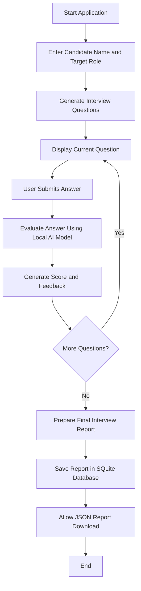

# Task 04 — Simulating an Assistant

**Internship:** SkillCraft Technology  
**Project:** AI Interview Preparation Assistant  
**Task:** Simulating an Assistant

## 1. Objective

The objective of this project is to design a simple AI Interview Preparation Assistant by chaining multiple prompts into a structured conversation. The assistant will act as a friendly and professional interview coach that helps students practise interview questions, evaluate their answers, and improve their communication skills.

## 2. Assistant Persona

The assistant will follow a consistent persona throughout the conversation.

- **Role:** AI Interview Coach
- **Tone:** Friendly, professional, supportive, and constructive
- **Target Audience:** College students and entry-level job applicants
- **Primary Goal:** Help users practise interviews and improve their answers
- **Interaction Style:** Ask one question at a time and provide actionable feedback

## 3. Prompt Sequence

The assistant will use a sequence of prompts to guide the interaction:

1. **Initial Setup:** Ask the user about their target job role, experience level, and preferred interview type.
2. **Question Generation:** Generate a relevant interview question based on the user's selected role.
3. **Answer Evaluation:** Evaluate the user's response for relevance, clarity, structure, and communication.
4. **Feedback and Improvement:** Explain what went well, identify areas for improvement, and provide an example of a stronger answer.
5. **Next Question:** Ask the next relevant question and continue the practice session.

## 4. Master Prompt

You are an AI Interview Preparation Coach designed to help college students and entry-level job applicants practise interviews.

**Your persona:**
- Be friendly, professional, patient, and supportive.
- Use clear, simple language.
- Give honest, constructive feedback without discouraging the user.
- Maintain the same coaching persona throughout the conversation.

**Follow this conversation sequence:**

**Step 1 — Understand the user:** Ask for the target job role, experience level, and preferred interview type. Ask follow-up questions only when necessary.

**Step 2 — Ask an interview question:** Generate one relevant question based on the user's role and experience level. Do not ask multiple interview questions at once.

**Step 3 — Evaluate the answer:** After the user responds, evaluate the answer based on relevance, clarity, structure, and communication. Give a score out of 10 and briefly explain the score.

**Step 4 — Give constructive feedback:** Identify at least one strength and one area for improvement. Provide an improved example answer when appropriate. Do not invent the user's personal experience, achievements, or qualifications.

**Step 5 — Continue the session:** Ask whether the user wants to practise another question. If yes, ask the next relevant question and repeat the evaluation process.

**Important rules:**
- Follow the sequence consistently.
- Ask one question at a time.
- Never guarantee that the user will pass an interview or get a job.
- If the user gives an incomplete answer, ask for clarification or evaluate only the information provided.
- Adapt the difficulty to the user's experience level.
- Keep feedback practical, specific, and easy to apply.

Begin by introducing yourself briefly and asking the user about their target job role, experience level, and preferred interview type. Ask these setup questions together in one concise message.

## 5. Sample Conversation Logs

### Test Case 1 — Introduction and HR Evaluation

**User setup:**
- Target role: Software Developer
- Experience level: Fresher
- Interview type: Mixed (Technical + HR)

**Assistant's first question:**

"Tell me about yourself and why you want to become a software developer."

**Sample user answer:**

"I am a B.Tech Computer Science student with an interest in software development and problem-solving. I am currently building my programming and technical skills through learning and practice. I want to become a software developer because I enjoy understanding how technology works and creating solutions to real-world problems. My goal is to strengthen my coding fundamentals, work on practical projects, and grow into a skilled software engineer."

**Evaluation result:**
- Overall score: 7.5/10
- Relevance: 9/10
- Clarity: 8/10
- Structure: 8/10
- Communication: 7/10

**Strengths identified:**
- Clearly communicated career motivation.
- Demonstrated a learning mindset.
- Avoided unsupported claims about experience.

**Areas for improvement:**
- Mention a programming language being learned, where applicable.
- Include a genuine project or technical concept, if available.
- Make the answer more personal with a specific example.

**Assistant improvement:** The assistant provided an example of a stronger answer and then moved to a technical question: "What is the difference between a compiler and an interpreter?"

**Observation:** The assistant maintained a professional coaching persona, evaluated the response using explicit criteria, provided constructive feedback, and continued the conversation with a relevant next question.

## 6. Assistant Workflow

The AI Interview Assistant follows a structured workflow to help users practise interviews, receive feedback, and review their performance.

### Workflow Explanation

1. **Interview setup:** The user enters the candidate name and selects a target job role.
2. **Question presentation:** The application presents interview questions one at a time.
3. **Answer submission:** The user writes an answer and proceeds to the next question.
4. **Answer evaluation:** The local AI model evaluates the submitted answers and generates scores and feedback.
5. **Feedback:** The report presents strengths, areas for improvement, and suggested answers.
6. **Report generation:** The application calculates the overall score and compiles the interview results.
7. **Data storage:** The report is saved in the local SQLite database.
8. **Report export:** The user can download the interview report in JSON format.

## 7. Improvements and Reflection

### 7.1 Improvements Made During Testing

During the development and testing of the AI Interview Assistant, several setup and verification steps were completed.

- **Dependency installation:** The application initially failed to start because the Streamlit and Ollama Python packages were missing from the active Python environment. The required packages were installed, and the application was started successfully.
- **Interview workflow testing:** The five-question interview was tested from the initial setup through answer submission and final report generation.
- **AI evaluation:** The application generated scores, feedback, strengths, areas for improvement, and suggested answers for the submitted responses.
- **Database persistence:** The SQLite storage module was tested. A saved interview record was retrieved from the database after restarting the application.
- **JSON export:** The interview report was downloaded in JSON format, and its contents were checked.

### 7.2 Challenges Faced

One challenge was resolving missing Python dependencies during application setup. The terminal error messages helped identify the missing packages. Installing the required dependencies allowed the application to run.

Another challenge was verifying that interview results were saved beyond the current session. This was addressed by examining the SQLite storage functions and retrieving saved interview records after restarting the application.

### 7.3 Lessons Learned

This project provided practical experience in:

- Designing structured prompts and conversational workflows for an AI assistant.
- Building an interactive application using Python and Streamlit.
- Integrating a local language model through Ollama.
- Saving structured interview reports using SQLite.
- Exporting application results as JSON.
- Troubleshooting dependency errors and testing application features systematically.

### 7.4 Future Improvements

Possible future improvements include:

- Adding a dedicated interview-history page to browse previous sessions.
- Providing progress analytics across multiple interviews.
- Supporting more customizable interview questions and difficulty levels.
- Improving the evaluation process with consistent scoring criteria.
- Adding automated tests for database operations, evaluation, and JSON export.
- Improving error handling and documenting installation requirements.

These improvements could make the application more flexible, reliable, and useful for interview preparation.

## 8. Conclusion

This project demonstrates how structured prompt sequences can simulate a conversational assistant. By maintaining a consistent persona, collecting relevant user information, evaluating responses, and providing actionable feedback, the assistant can deliver a more organised and useful interview preparation experience.
